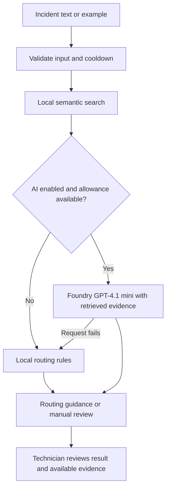

# TicketRoute

**IT incident routing with historical evidence and optional AI guidance.**

## Live demo

**[Open TicketRoute](https://ca-ticketroute.nicedesert-9599d184.swedencentral.azurecontainerapps.io/)**

The deployed public version currently uses **local routing**. The RAG integration
is implemented in the application but has not yet been enabled in Azure.
Try an example incident or paste fictional incident text, then select **Find assignment group**.

## Overview

IT service desks often need to decide which support team should own an incident.
Incorrect assignments cause repeated ticket transfers, extra administrative work,
and delays for users. TicketRoute helps technicians make that decision by finding
similar resolved incidents and recommending an assignment group with supporting evidence.

The intended value is faster triage, fewer unnecessary transfers, and more consistent
routing. A technician remains responsible for the decision: TicketRoute provides
guidance and does not automatically assign tickets or update ServiceNow.

## How it works

1. **Describe the incident.** Copy the short description and/or description from
   ServiceNow, or choose one of the built-in fictional examples.
2. **Find similar incidents.** A local embedding model converts text into numerical
   representations of meaning. Semantic search compares these representations to
   retrieve up to five similar historical incidents, even when their wording differs.
3. **Generate routing guidance.** Local routing weighs the retrieved evidence to
   recommend a team, suggest candidate teams, or request manual review. When enabled,
   retrieval-augmented generation (**RAG**) sends the incident and retrieved examples
   to **GPT-4.1 mini in Microsoft Foundry** for a recommendation and short explanation.
   Recommended team names are validated against the supplied historical evidence.
4. **Review the result.** Technicians can inspect the similar incidents and their
   resolutions. A manual-review result asks a technician to determine the appropriate
   team when the system cannot provide a recommendation.

If Azure configuration is missing or an AI request fails, the application uses
local routing. Local routing still uses semantic search; it does not require an LLM.



## Azure architecture

- **Streamlit** provides the browser interface and runs the Python routing logic.
- **Docker** packages the application, synthetic data, and local embedding model.
- **Azure Container Registry (ACR)** stores the container image.
- **Azure Container Apps** hosts the container and exposes the public HTTPS demo.
- **Managed identity** supports private image pulls from ACR without registry passwords.
  The current Foundry client uses an API key, not managed identity authentication.
- **Microsoft Foundry** provides the optional GPT-4.1 mini deployment. Public-demo
  AI routing remains disabled until its Azure configuration is enabled.

**GitHub Actions CI/CD** runs Python tests first. Pull requests to `main` then
verify the Docker build without deploying. Pushes to `main` build an image tagged
with the commit SHA, authenticate to Azure through OIDC, push to `ticketrouteacr`,
and update `ca-ticketroute` in `rg-ticketroute` to use that image. Only the image
is updated; existing environment variables, secrets, identities, and ingress remain.
Authentication uses the repository's `AZURE_CLIENT_ID`, `AZURE_TENANT_ID`, and
`AZURE_SUBSCRIPTION_ID` secrets with an Azure federated credential for `main`;
no Azure client secret or AI API key is needed by the workflow.

## Technology stack

Python 3.12, Streamlit, Sentence Transformers (`all-MiniLM-L6-v2`), NumPy, pandas,
the OpenAI Python SDK for Foundry, pytest, Docker, and Azure Container Apps/ACR.
The application searches local CSV data; it does not require a separate vector database.

## Run locally

From the repository root, using Python 3.12 and Windows PowerShell:

```powershell
python -m venv .venv
.\.venv\Scripts\Activate.ps1
python -m pip install -r requirements.txt
python -m streamlit run app.py
```

Open `http://localhost:8501`. The first local run may download the embedding model.
No Azure credentials are needed for local routing.

To enable RAG, set `AZURE_OPENAI_ENDPOINT`, `AZURE_OPENAI_API_KEY`, and
`AZURE_OPENAI_DEPLOYMENT` in the environment before starting the app. The deployment
must host GPT-4.1 mini. Keep credentials out of source control.

## Run with Docker

With Docker running in Linux container mode:

```powershell
docker build -t ticketroute:local .
docker run --rm -p 8501:8501 ticketroute:local
```

Open `http://localhost:8501`. The build requires internet access to install dependencies
and bundle the embedding model; the model runs locally at runtime. For optional RAG,
forward the three Azure environment variables with Docker's `--env` flags.

## Evaluation and limitations

Evaluation uses separate synthetic incidents to examine routing correctness,
recommendation coverage, and appropriate manual review. These examples help assess
behavior but **do not establish production accuracy**. Similar symptoms can have
different causes; recommendations depend on the available history and may be wrong.
RAG adds explanations but does not remove the need for human judgment.

The application limits descriptions to 5,000 characters, enforces a three-second
cooldown, and allows 30 LLM attempts per browser session, including failed attempts.
After the allowance is exhausted, it continues with local routing and a visible notice.
**New browser sessions bypass the session limit; this is not a hard Azure spending limit.**

## Data and privacy

The included incidents and examples are synthetic. Use fictional text in the public
demo; do not submit personal information, credentials, or confidential incident details.
When RAG is enabled, the submitted text and retrieved historical context are sent to
Microsoft Foundry. The ServiceNow workflow is manual copy/paste, with no direct integration.
