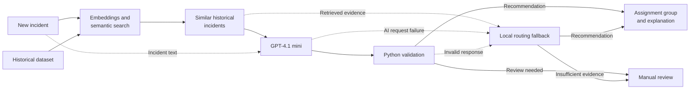
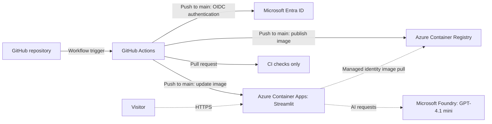

# TicketRoute

**AI-Assisted IT Incident Routing**

TicketRoute helps IT service desks identify the right support team for an incident.
It combines historical incident evidence with AI reasoning to support faster, more consistent triage.

## Live application

**[Open TicketRoute](https://ca-ticketroute.nicedesert-9599d184.swedencentral.azurecontainerapps.io/)**

Hosted on **Azure Container Apps**, with **Microsoft Foundry GPT-4.1 mini RAG enabled**
and local routing available as a fallback.
Try an example incident or paste fictional incident text, then select **Find assignment group**.

## Overview

In complex IT environments, identifying the right support team is not always straightforward. Service ownership knowledge is often scattered across documentation, personal notes, and the experience of individual technicians. Staff turnover and changing responsibilities make this knowledge difficult to maintain, leading to incorrect assignments, repeated transfers, duplicated triage, and delayed resolution.

TicketRoute addresses this challenge by using previously resolved incidents as a shared source of knowledge. Through semantic search and AI-assisted recommendations, it helps service desk and second-line support teams identify the most appropriate assignment group using historical evidence.

By reducing time spent identifying the responsible team and minimizing unnecessary handoffs, TicketRoute allows IT support teams to focus on what matters most: **resolving incidents, restoring services, and getting users back to work.**

## How it works

1. **Describe the incident.** Copy the short description and/or description from
   ServiceNow.
2. **Search historical evidence.** A local embedding model represents incident text
   as numerical vectors. Semantic search uses these vectors to retrieve up to five
   similar resolved incidents, even when their wording differs.
3. **Assess team ownership.** The new incident and retrieved evidence are sent as
   text to **GPT-4.1 mini**. This RAG pipeline produces a proposed assignment group
   and an explanation based on the supplied incident context.
4. **Validate the response.** Python checks the response structure and ensures any
   recommended group appears in the retrieved evidence.
5. **Review the guidance.** Technicians inspect the recommendation and historical
   evidence. Insufficient evidence can produce a manual-review outcome.

If AI is unavailable or a response fails validation, local routing uses the search
results to recommend a team, suggest candidates, or request manual review.

## RAG architecture



## Azure architecture and CI/CD

**Azure Container Apps** hosts the Docker-packaged Streamlit application without
requiring the team to operate Kubernetes. **Azure Container Registry (ACR)** stores
the image, and **Microsoft Foundry** handles AI requests.



Solid arrows show deployment and authentication; dotted arrows show runtime requests.
Pushes to `main` run tests, build and publish the Docker image, then deploy it.
Pull requests run tests and verify the build without deploying. Existing app settings are preserved.

## Engineering decisions

- **Local retrieval:** embeddings and CSV-based search keep the evidence pipeline
  simple, without a separate vector database.
- **Grounded AI guidance:** retrieved incidents supply context; Python validates
  permitted group names.
- **Resilient routing:** deterministic local rules provide a fallback, while manual
  review keeps uncertain cases with technicians.
- **Repeatable delivery:** Docker bundles the model and application. OIDC authenticates
  deployments; managed identity handles ACR pulls. Foundry requests currently use an API key.

## Technology stack

Python 3.12, Streamlit, Sentence Transformers (`all-MiniLM-L6-v2`), NumPy, pandas,
OpenAI Python SDK, pytest, Docker, and Azure. Search uses local CSV data.

## Run locally

From the repository root, using Python 3.12 and Windows PowerShell:

```powershell
python -m venv .venv
.\.venv\Scripts\Activate.ps1
python -m pip install -r requirements.txt
python -m streamlit run app.py
```

Open `http://localhost:8501`. The first local run may download the embedding model.
No Azure credentials are needed for local routing.

To enable RAG, set `AZURE_OPENAI_ENDPOINT`, `AZURE_OPENAI_API_KEY`, and
`AZURE_OPENAI_DEPLOYMENT` in the environment before starting the app. The deployment
must host GPT-4.1 mini. Keep credentials out of source control.

## Run with Docker

With Docker running in Linux container mode:

```powershell
docker build -t ticketroute:local .
docker run --rm -p 8501:8501 ticketroute:local
```

Open `http://localhost:8501`. Building requires internet access; the bundled embedding
model runs locally. For RAG, forward the Azure variables with Docker's `--env` flags.

## Evaluation and roadmap

TicketRoute includes a set of synthetic test incidents to evaluate how well it identifies the right support team and when it should recommend manual review.

The next step would be to evaluate it using anonymized historical ServiceNow incident data.

A future ServiceNow integration could bring these recommendations directly into the incident workflow.

## Data and privacy

TicketRoute uses synthetic incident data for development and evaluation. The public application is intended for fictional incident descriptions, not confidential operational information.
AI requests send submitted text and retrieved historical context to Microsoft Foundry.
