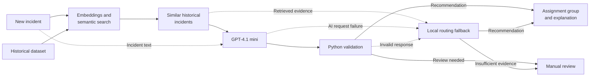
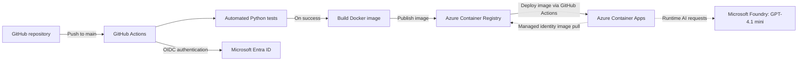

# TicketRoute

**AI-Assisted IT Incident Routing**

TicketRoute helps IT service desks identify the right support team for an incident.
It combines historical incident evidence with AI reasoning to support faster, more consistent triage.

## Live application

**[Open TicketRoute](https://ca-ticketroute.nicedesert-9599d184.swedencentral.azurecontainerapps.io/)**

Hosted on **Azure Container Apps**, with **Microsoft Foundry GPT-4.1 mini RAG enabled**
and local routing available as a fallback.
Try an example incident or paste fictional incident text, then select **Find assignment group**.

## Overview

In complex IT environments, identifying the right support team is not always straightforward. Service ownership knowledge is often scattered across documentation, personal notes, and the experience of individual technicians. Staff turnover and changing responsibilities make this knowledge difficult to maintain, leading to incorrect assignments, repeated transfers, duplicated triage, and delayed resolution.

TicketRoute addresses this challenge by using previously resolved incidents as a shared source of knowledge. Through semantic search and AI-assisted recommendations, it helps service desk and second-line support teams identify the most appropriate assignment group using historical evidence.

By reducing time spent identifying the responsible team and minimizing unnecessary handoffs, TicketRoute allows IT support teams to focus on what matters most: **resolving incidents, restoring services, and getting users back to work.**

## How it works

1. **Describe the incident.** Copy the text from the Short description and Description
   fields in ServiceNow, or enter an incident manually.
2. **Find similar incidents.** TicketRoute uses semantic search to find up to five
   similar resolved incidents, even when they are described using different words.
3. **Recommend a support team.** GPT-4.1 mini analyzes the new incident alongside
   historical evidence and recommends an assignment group with an explanation.
4. **Validate the recommendation.** Python checks that the AI response is valid and
   that the recommended group is supported by the retrieved incidents.
5. **Review the result.** Technicians receive a recommended assignment group and can
   inspect similar historical incidents before routing the ticket. If the evidence
   is insufficient, TicketRoute can recommend manual review.

If AI is unavailable or a response fails validation, local routing uses the search
results to recommend a team, suggest candidates, or request manual review.

## RAG architecture



## Azure architecture and CI/CD

**Azure Container Apps** hosts the Docker-packaged Streamlit application without
requiring the team to operate Kubernetes. **Azure Container Registry (ACR)** stores
the image, and **Microsoft Foundry** handles AI requests.



Every push to `main` triggers GitHub Actions to run the tests, build a Docker image,
publish it to Azure Container Registry, and deploy the updated image to Azure Container Apps.

## Engineering decisions

- **Local search:** historical incidents stay in a CSV file and are searched locally,
  without a separate search database.
- **Grounded AI guidance:** similar incidents provide evidence; Python checks that
  the recommended team appears in that evidence.
- **Resilient routing:** If the AI service is unavailable, TicketRoute can still
  recommend a support team based on similar historical incidents. Uncertain cases
  are flagged for manual review.
- **Repeatable delivery:** Docker bundles the model and application. GitHub Actions
  authenticates to Azure through Microsoft Entra ID using OIDC, without a stored
  Azure login password. Azure Container Apps uses managed identity to pull images
  from Azure Container Registry.

## Technology stack

Python 3.12, Streamlit, Sentence Transformers (`all-MiniLM-L6-v2`), NumPy, pandas,
OpenAI Python SDK, pytest, Docker, and Azure. Search uses local CSV data.

## Run locally

Python 3.12 is required. From the repository root, create a virtual environment:

```sh
python -m venv .venv
```

Activate it in Windows PowerShell:

```powershell
.\.venv\Scripts\Activate.ps1
```

Or on macOS/Linux:

```sh
source .venv/bin/activate
```

Install dependencies and start the app:

```sh
python -m pip install -r requirements.txt
python -m streamlit run app.py
```

Open `http://localhost:8501`. The first local run may download the embedding model.
No Azure credentials are needed for local routing.

To enable RAG, set `AZURE_OPENAI_ENDPOINT`, `AZURE_OPENAI_API_KEY`, and
`AZURE_OPENAI_DEPLOYMENT` in the environment before starting the app. The deployment
must host GPT-4.1 mini.

## Run with Docker

With Docker running in Linux container mode:

```powershell
docker build -t ticketroute:local .
docker run --rm -p 8501:8501 ticketroute:local
```

Open `http://localhost:8501`. Building requires internet access; the bundled embedding
model runs locally. For RAG, forward the Azure variables with Docker's `--env` flags.

## Evaluation and next steps

TicketRoute uses 120 synthetic historical incidents to support its recommendations and 30 additional test incidents to evaluate how accurately its local routing assigns tickets.

The next step would be to evaluate it using anonymized historical ServiceNow incident data.

A future ServiceNow integration could bring these recommendations directly into the incident workflow.

## Data and privacy

TicketRoute uses synthetic incident data for development and evaluation. The public application is intended for fictional incident descriptions, not confidential operational information.
AI requests send submitted text and retrieved historical context to Microsoft Foundry.
